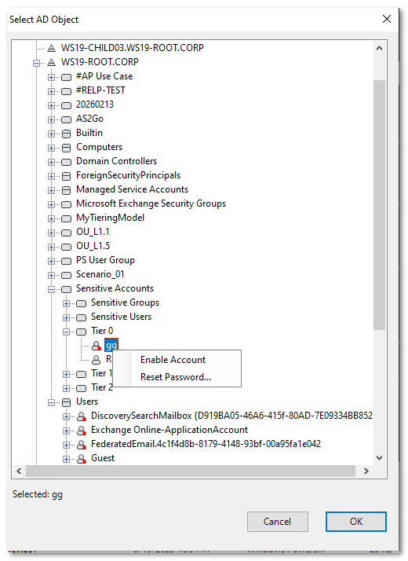

# ADObjectPicker


```Text
Author:          Holger Zimmermann | zimmermann.holger@live.de
Current Version: 2026.11.19.1371
Last Update:     2026-11-19
```

**ADObjectPicker** is a PowerShell module for browsing Active Directory forests and selecting objects through a graphical Windows Forms dialog. Its exported command, `Select-ADObject`, returns the distinguished name of the selected object for use in your scripts.

I originally developed `Select-ADObject` for my AS2Go (Attack Scenario to Go) PowerShell module. Since it can also be useful in other scripts and administrative workflows, I wanted to make it available to everyone as the standalone ADObjectPicker module. Feel free to use it in your own projects! :-)

The module is available from the [PowerShell Gallery](https://www.powershellgallery.com/packages/ADObjectPicker). It is compatible with **Windows PowerShell 5.1**; **PowerShell 7.4 on Windows is recommended**.




## Overview

ADObjectPicker provides the `Select-ADObject` command to browse and select Active Directory objects in a forest. Child objects are loaded on demand when a node is expanded, so large forests stay responsive.

- Browse the forest hierarchy across **multiple domains**
- Select **OUs, containers, users, groups, computers, GPOs** and **domains**
- Restrict the view to the **local domain** only
- **Highlight Tier 0 objects** with a red dot (regex based, customizable)
- Mark **disabled user and computer accounts** with a red cross
- Enable or disable **user accounts** from the context menu
- **Reset user passwords** from the context menu, optionally forcing a change at next logon
- **Block the selection of OUs/containers** while still browsing through them (e.g. to pick only users)
- Optionally **create new OUs** from a context menu
- Optionally show **linked GPOs** below each domain, OU or container
- Returns the **distinguished name (DN)** of the selected object

### Icon legend

| Marker | Meaning |
|--------|---------|
| Red dot (top right) | Tier 0 object (`-MarkTier0`) |
| Red cross (bottom right) | Disabled user or computer account |

Both markers can appear on the same icon.

## Project Information

- Author: Holger Zimmermann
- Module: `ADObjectPicker`
- Public command: `Select-ADObject`
- Project: [ADObjectPicker on GitHub](https://github.com/HerrHozi/ADObjectPicker)
- Package: [ADObjectPicker on the PowerShell Gallery](https://www.powershellgallery.com/packages/ADObjectPicker)
- License: MIT

## Module Structure

- `ADObjectPicker.psd1`: module metadata and public exports
- `ADObjectPicker.psm1`: loads private helpers and public commands
- `Public/`: exported PowerShell commands
- `Private/`: internal helper functions
- `ChangeLog.md`: local version history

## Requirements

- Windows with a graphical environment
- Windows PowerShell 5.1 (compatible) or PowerShell 7.4 on Windows (recommended)
- **No ActiveDirectory module (RSAT) required**: browsing, OU creation, account enable/disable and password reset all use System.DirectoryServices and ADSI
- Read access to the forest
- `System.Windows.Forms`, `System.Drawing` and `System.DirectoryServices` (loaded by the function)

## Installation

### Install from the PowerShell Gallery

Install the module for your current Windows user:

```powershell
Install-Module -Name ADObjectPicker -Repository PSGallery -Scope CurrentUser
Import-Module -Name ADObjectPicker
```

### Import from a local checkout

From the folder containing `ADObjectPicker.psd1` (the Dev folder in this project layout):

```powershell
Import-Module .\ADObjectPicker.psd1 -Force
```

### Update a Gallery installation

```powershell
Update-Module -Name ADObjectPicker
```

## Quick Start

```powershell
Import-Module -Name ADObjectPicker

$SelectedDN = Select-ADObject -IncludeUsers -BlockOUSelection -Title 'Select a user'
if ($SelectedDN) {
    Write-Output $SelectedDN
}

Get-Help Select-ADObject -Full
```

## Usage

```powershell
# Browse the forest and select an OU, container or other object
Select-ADObject

# Pick a break glass account, highlight Tier 0 objects
Select-ADObject -MarkTier0 -IncludeUsers -Title "Select Break Glass Account"

# Only users can be selected, OUs are browsable but not selectable
Select-ADObject -IncludeUsers -BlockOUSelection -Title "Select User"

# Local domain only, users and groups included
Select-ADObject -LocalDomainOnly -IncludeUsers -IncludeGroups

# Select a domain
Select-ADObject -DomainSelectionOnly

# Allow creating new OUs via right click > New > Organizational Unit
Select-ADObject -AddOU -Title "Select Target OU"
```

The result is the DN of the selection, or `$null` if the dialog was cancelled:

```powershell
$dn = Select-ADObject -IncludeUsers -BlockOUSelection
if ($dn) { Get-ADUser -Identity $dn }
```

### Use a specific domain controller

```powershell
Select-ADObject -DomainController 'dc01.contoso.com' -LocalDomainOnly -IncludeUsers
```

The supplied DC determines the forest and is used for browsing and changes in its own domain.
Other domains in that forest use automatic controller selection. `-LocalDomainOnly` restricts
selection to the supplied DC's domain. Without `-DomainController`, automatic discovery is unchanged.
An unreachable or invalid controller causes an error instead of silently using another controller.
The current Windows credentials are used; this parameter does not supply alternate credentials.

### Enable or disable a user account

Run `Select-ADObject -IncludeUsers`, expand the user's container, and right-click the user. Choose **Disable Account** for an enabled account or **Enable Account** for a disabled account. The action runs immediately when selected. After a successful change, the red cross on the user icon updates.

### Reset a user's password

Run `Select-ADObject -IncludeUsers`, expand the user's container, right-click the user and choose **Reset Password...**. Enter the new password twice and optionally tick **User must change password at next logon**. The reset runs immediately after confirming and uses the ADSI `SetPassword` method, so no ActiveDirectory module is needed. The new password must satisfy the domain password policy; otherwise the error returned by the domain controller is shown. The password is never stored or logged.

## Parameters

<details>
<summary><b>Selection Scope</b></summary>

| Parameter | Type | Default | Description |
|-----------|------|---------|-------------|
| `Title` | String | `Select AD Object` | Text shown in the dialog title bar. |
| `DomainController` | String | Automatic | DNS name of the DC used to discover the forest and access its own domain. Other domains use automatic controller selection. |
| `LocalDomainOnly` | Switch | False | Show only the current domain, or the supplied controller's domain when DomainController is set. |
| `DomainSelectionOnly` | Switch | False | Only domains can be selected. The tree is not expanded below the domain level. |
| `BlockOUSelection` | Switch | False | OUs and containers can be browsed but not selected (OK stays disabled). Use together with `-IncludeUsers`, `-IncludeGroups`, `-IncludeComputers` or `-IncludeGPOs`. |
| `AddOU` | Switch | False | Adds a context menu to create an organizational unit below a domain, OU or container. |
| `ShowAdvanced` | Switch | False | Also show objects flagged with `showInAdvancedViewOnly`. |

</details>

<details>
<summary><b>Object Types</b></summary>

| Parameter | Type | Default | Description |
|-----------|------|---------|-------------|
| `IncludeUsers` | Switch | False | Include user objects in the tree. Disabled users are marked with a red cross. |
| `IncludeGroups` | Switch | False | Include group objects in the tree. |
| `IncludeComputers` | Switch | False | Include computer objects in the tree. Disabled computers are marked with a red cross. |
| `IncludeGPOs` | Switch | False | Include GPO objects (`groupPolicyContainer`) in the tree. |
| `IncludeLinkedGPOs` | Switch | False | Show GPOs linked to a domain, OU or container as child entries. |

</details>

<details>
<summary><b>Security / Tier 0 Handling</b></summary>

| Parameter | Type | Default | Description |
|-----------|------|---------|-------------|
| `MarkTier0` | Switch | False | Marks Tier 0 objects with a red dot on their icon. |
| `Tier0Regex` | String | `(?i)(^CN=Administrator,\|^OU=Domain Controllers,\|^OU=Tier\s*0\|^OU=T0)` | Regular expression matched against the DN to identify Tier 0 objects. |

</details>

## Output

| Type | Description |
|------|-------------|
| `System.String` | Distinguished name of the selected object, or `$null` if cancelled. |

## Selection rules

- The forest node and domain nodes are not selectable (except domains with `-DomainSelectionOnly`).
- With `-BlockOUSelection`, objects of class `organizationalUnit`, `container` and `builtinDomain` are not selectable.

## Security Considerations

- Browsing requires directory read permissions. Creating OUs, changing user account status and resetting passwords require the corresponding write permissions (e.g. *Reset Password*) in the target domain. For password changes, use a secure LDAP connection where your environment demands it.
- Tier 0 detection is regex based and can be customized with `-Tier0Regex`
- Selecting an OU creation, user account or password reset action changes Active Directory.
- Stores no credentials
- Intended for administrative use

## Limitations

- Requires a GUI, not headless-compatible
- Performance depends on the size of the forest and the number of child objects per container
- The disabled marker is based on `userAccountControl` and therefore applies to users and computers only

## License

This project is licensed under the [MIT License](LICENSE).

Copyright (c) 2026 Holger Zimmermann
